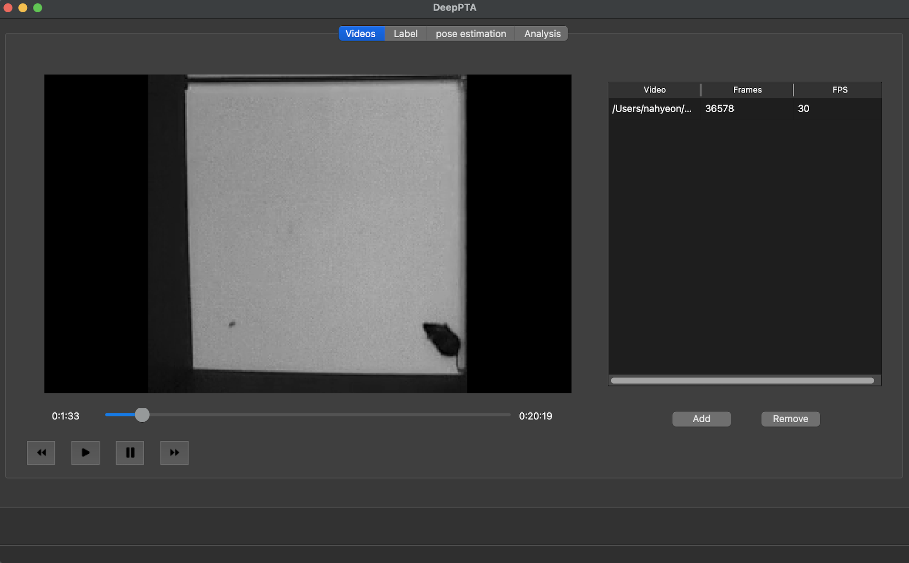
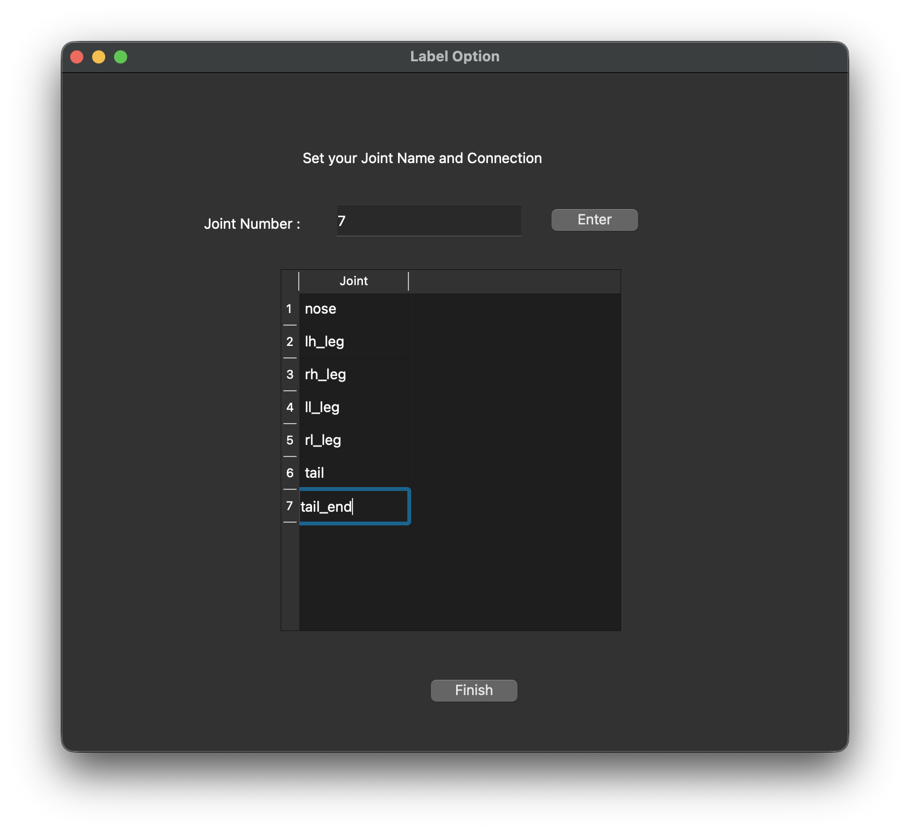
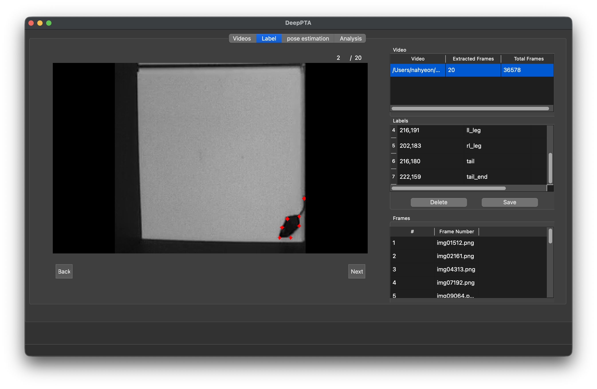
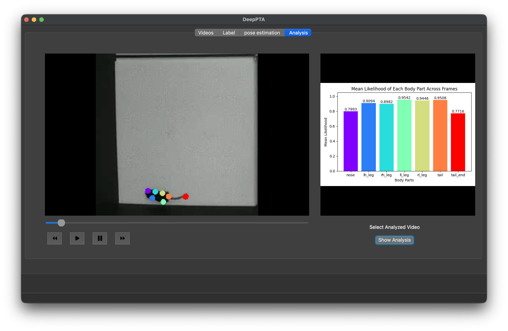

# deepPTA

> 동물 행동 실험용 자세 추정(pose estimation) 데스크톱 앱  
> 🏆 한양대학교 캡스톤디자인 발표회 **장려상** (2024)

<p align="center">
  
  <br>
  <sub>메인 화면 · 비디오 추가 및 처리 탭</sub>
</p>

자세 추정 기술은 스포츠·의학·로봇공학 등 여러 분야에서 쓰이지만, 활용하려면 프로그래밍 기술과 복잡한 알고리즘 이해가 필요해 많은 사용자가 쉽게 접근하기 어렵습니다. DeepLabCut도 GUI가 있지만 설치·실행과 오류 확인은 터미널에서, 관절 설정은 `config.yaml`을 직접 수정해야 합니다.

deepPTA는 **프로그래밍 지식 없이도** 영상 추가부터 라벨링·학습·분석까지 **전 과정을 하나의 GUI에서 처리**할 수 있도록 만든 PyQt5 기반 데스크톱 앱입니다. DeepLabCut 프로젝트 파일을 직접 다룰 필요가 없습니다.

> 이 프로젝트는 DeepLabCut(AGPL-3.0)을 의존성으로 사용하며, DeepLabCut 자체는 이 저장소에 포함되어 있지 않습니다.

**Tech Stack** · Python · PyQt5 · DeepLabCut · OpenCV

## 워크플로우

```
영상 추가 → 프레임 샘플 추출 → 조인트 이름 설정 → 프레임마다 클릭 라벨링
    → CollectedData CSV 저장 → DeepLabCut 모델 학습 → 예측 결과 분석
```

## 주요 기능

<table>
  <tr>
    <td align="center" width="33%"></td>
    <td align="center" width="33%"></td>
    <td align="center" width="33%"></td>
  </tr>
  <tr>
    <td valign="top">
      <b>1. 프레임 추출 · 라벨 옵션 설정</b><br>
      • 추출할 프레임 수를 입력하면 전체 구간에서 균등하게 추출<br>
      • 관절 포인트의 개수와 이름을 창에서 바로 지정
    </td>
    <td valign="top">
      <b>2. 프레임 라벨링</b><br>
      • 프레임을 클릭해 관절 좌표를 라벨링, 라벨 삭제·재설정 지원<br>
      • 라벨 좌표를 저장하고 학습 데이터로 변환
    </td>
    <td valign="top">
      <b>3. 모델 학습 · 결과 분석</b><br>
      • 학습 파라미터를 입력해 학습을 실행하고 새 영상에 포즈 추정<br>
      • 관절 포인트별 평균 신뢰도(likelihood) 그래프와 결과 영상 표시
    </td>
  </tr>
</table>

## 학습 결과

| 지표 | 결과 |
|---|---|
| 훈련 데이터셋 정확도 | **95%** |
| Loss | **0.0534 → 0.0058** |
| 조건 | ResNet-50 · 100,000 iterations · 추출 프레임 20장 |

복잡한 움직임에서는 일부 한계가 있어, 데이터 증강·파라미터 튜닝·데이터셋 확대로 개선할 계획입니다.

## 폴더 구조

```
code/
├── __init__.py
├── __main__.py              # 실행 진입점 (python -m code)
├── main_window.py           # UI: 위젯과 핸들러 연결만 담당
├── state.py                 # 상태: ProjectState 데이터클래스 하나를 모든 창이 공유
├── video_player.py          # 로직: 영상 재생
├── labeling_controller.py   # 로직: 라벨링 컨트롤러
├── geometry.py              # 로직: 좌표 변환 (단위 테스트 포함)
├── dialogs.py               # 라벨 옵션 등 보조 창
├── dlc.py                   # 연동: DeepLabCut 호출·호환 패치
└── analysis.py              # 연동: 신뢰도 그래프
ui/                          # Qt Designer .ui 파일들
assets/icons/                # 재생 버튼 아이콘
assets/screenshots/          # README용 스크린샷
```

## 설치 방법

```bash
conda create -n deepPTA python=3.9
conda activate deepPTA
./install.sh
```

Apple Silicon에서 DeepLabCut 2.3.x가 필요로 하는 Python 3.9 환경을 기준으로 합니다.

### 트러블슈팅 (install.sh가 처리하는 내용)

| 문제 | 원인 | 해결 |
|---|---|---|
| Apple Silicon 설치 실패 | DeepLabCut이 고정한 `tables 3.8.0`에 arm64용 wheel이 없음 | conda로 tables를 먼저 설치한 뒤 `--no-deps`로 우회 |
| TensorFlow · Keras 버전 충돌 | TF 2.16부터 기본값이 Keras 3 | `tf-keras`로 레거시 Keras 설정 + 모듈 경로 별칭으로 DeepLabCut 2.3 호환 처리 |

## 실행

```bash
python -m code
```

## 한계점 및 향후 추가 내용

- 프레임 추출은 아직 한 번에 영상 하나만 라벨링한다고 가정함
- 학습/추론 호출 중에 진행 상황 표시 추가
- 복잡한 움직임 대응을 위한 데이터 증강 · 파라미터 튜닝 · 데이터셋 확대
